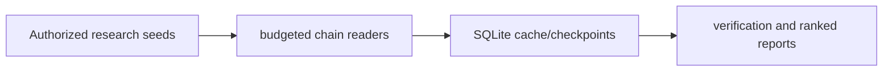

# Multichain Transaction Analyzer

**Budgeted EVM/Solana research with checkpoints and evidence-qualified reports.**

  [](LICENSE)

[Overview](#overview) · [Quickstart](#quickstart) · [Example](#example) · [Validation](#validation) · [Documentation](#documentation)

## Overview

A resumable EVM/Solana transaction research pipeline with request budgets, cached evidence and ranked output.

**Stack:** Python · SQLite · HTTP/RPC readers · JSON/CSV · pycryptodome

## Research that can resume

| Component | Behavior |
| --- | --- |
| Readers | EVM and Solana adapters normalize public transaction observations. |
| Budgets | Request limits and checkpoints bound collection work. |
| Reports | Cached evidence supports verification and ranked JSON/CSV output. |

## Processing path



## Quickstart

```console
python -m venv .venv
# Activate .venv, then:
python -m pip install -e .
python -m unittest discover -s tests -p test_forensics.py -v
```

The commands above install prerequisites or run the specified offline checks. Live collection, cloud operations, messaging and trading are separate operational steps when present.

## Example

**Inspect the workflow**

Begin with configured research seeds, inspect a bounded reader run and retain its SQLite checkpoint. Resume from stored state rather than interpreting a partial run as complete. Report evidence and unresolved cases alongside rankings; a transaction correlation is not a claim about a person.

## Configuration and storage

Python 3.11+, SQLite and HTTP/RPC readers. Provider configuration and request budgets are required for live collection. Prior research outputs are not bundled.

## Repository guide

| Location | Responsibility |
| --- | --- |
| [wallet_forensics/evm.py](wallet_forensics/evm.py) | EVM reader |
| [wallet_forensics/solana.py](wallet_forensics/solana.py) | Solana reader |
| [wallet_forensics/pipeline.py](wallet_forensics/pipeline.py) | Research pipeline |
| [wallet_forensics/ranking.py](wallet_forensics/ranking.py) | Ranked views |

## Validation

These checks use offline fixtures or controlled backends.

## Scope and operational boundaries

Public-chain evidence does not establish wallet ownership or identity. Provider calls consume quotas; offline tests do not establish present RPC coverage or completeness.

## Documentation

- The repository guide above links directly to the implementation and configuration files.

## License and attribution

Project-authored source code is licensed under the [MIT License](LICENSE). Third-party components and datasets retain their respective rights and licenses.
