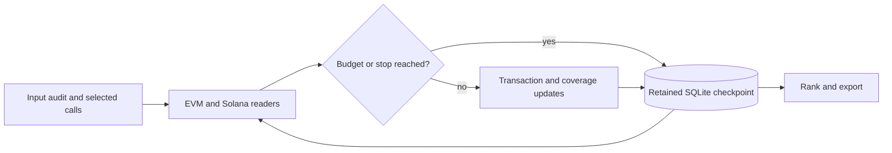

# Multichain Transaction Analyzer

  [](LICENSE)

Investigate EVM and Solana transaction observations with bounded requests, persistent checkpoints and evidence-qualified reports.

The collector is designed to stop and resume. It keeps source audit state, processed transactions and coverage in SQLite, rather than assuming that an interrupted network run is a complete research result.

## The command model

[wallet_forensics/__main__.py](wallet_forensics/__main__.py) exposes distinct stages:

| Stage | Commands |
| --- | --- |
| Source/local state | `audit`, `status`, `verify` |
| Network collection | `probe`, `discover`, `collect`, `run`, `seed-check` |
| Derived outputs | `rank`, `report` |
| Cooperative stop | `stop` |

Collection accepts chain selection, transaction/page limits and a hard request budget (`--budget`, default 3000). A directory lock prevents two collectors from writing the same output concurrently. Budget exhaustion records a checkpointed stop instead of reporting success for missing coverage.

## Local setup

```console
python -m pip install -e .
python -m wallet_forensics --help
python -m unittest discover -s tests -p test_forensics.py -v
```

Use Python 3.11+ in an activated virtual environment. The focused tests use offline inputs; provider credentials and original research outputs are not bundled.

## Resumable evidence path



[evm.py](wallet_forensics/evm.py) and [solana.py](wallet_forensics/solana.py) implement chain-specific reads; [ranking.py](wallet_forensics/ranking.py) and [report.py](wallet_forensics/report.py) derive views from retained evidence. Public transaction correlation does not prove personal identity, wallet ownership or complete provider coverage.

**Technology:** Python · SQLite · HTTP/RPC readers · JSON/CSV · pycryptodome

Project-authored source: [MIT](LICENSE). Third-party components retain their own notices and terms.
